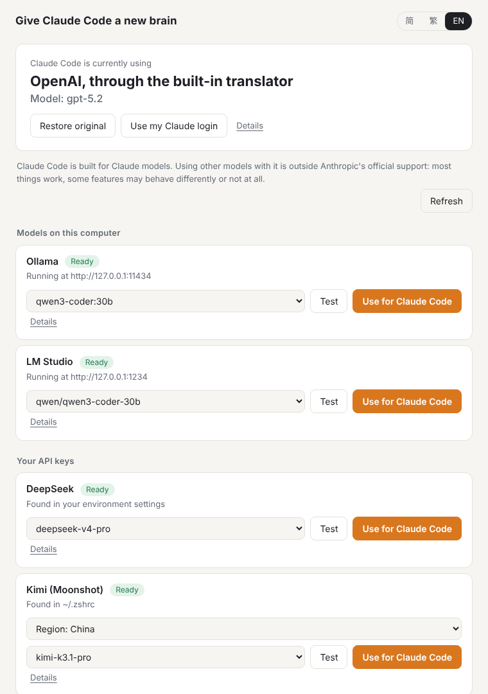

# wickrun-brain

Give Claude Code a new brain. A small desktop app that shows which models this computer can use, and switches Claude Code to one of them with one click. Your original settings come back with one click too.

English | [简体中文](README.zh-CN.md)

<picture>
  <source media="(prefers-color-scheme: dark)" srcset="docs/screenshots/gui-en-dark.png">
  
</picture>

## Download

Get the installer for your system from the [Releases page](https://github.com/lifishard/wickrun-brain/releases): `.msi` or `.exe` for Windows, `.dmg` for macOS, `.deb`, `.rpm` or `.AppImage` for Linux. Double-click and use it. You do not need Node.js, a terminal, or the wickrunAI app.

The installers are not signed yet, so your system will warn you the first time:

- **Windows:** SmartScreen says "Windows protected your PC". Click **More info**, then **Run anyway**.
- **macOS:** if it says the app "is damaged" or "cannot be opened", open **System Settings → Privacy & Security** and click **Open Anyway** next to wickrun-brain. If there is no such button, run `xattr -dr com.apple.quarantine /Applications/wickrun-brain.app` in Terminal once.
- **Linux:** for the AppImage, mark it executable (`chmod +x wickrun-brain_*.AppImage`) and run it.

## What you see

**At the top:** what Claude Code is using right now, in plain words, with **Restore original** (puts the settings file back exactly as it was before this app first changed it) and **Use my Claude login**.

**Below:** everything the app found, in groups. Each entry has a status (Ready, Needs a key, Not usable here), a model picker when the source lists its models, a **Test** button that sends one tiny request first, and **Use for Claude Code**. Technical details (addresses, which setting holds the key, the masked key) sit behind **Details**.

| Group | What it looks for | How |
| --- | --- | --- |
| Models on this computer | Ollama, LM Studio, llama.cpp server, vLLM, Jan | Their default ports on 127.0.0.1 (11434, 1234, 8080, 8000, 1337); the model list from `/api/tags` or `/v1/models` |
| Your API keys | DeepSeek, Kimi (Moonshot), Zhipu GLM, Z.ai, Qwen (DashScope), MiniMax, OpenRouter, Anthropic, OpenAI, Google Gemini, Groq | Environment variables (for example `DEEPSEEK_API_KEY`), `export` lines in your shell profile (`~/.zshrc`, `~/.bashrc`, `~/.profile`, fish, PowerShell profile), `~/.codex/auth.json`, and profiles saved with the wickrun-brain command line tool. Only a masked form is shown (`…7f3a`) |
| From CC Switch | The Claude Code providers you saved in [CC Switch](https://github.com/farion1231/cc-switch) | Reads `~/.cc-switch/cc-switch.db` (or the folder you moved it to, or the older `config.json`) from a temporary copy, so CC Switch's own file is never locked or changed |
| Gateways on this computer | OmniRoute, Claude Code Router, LiteLLM, one-api, new-api | Their default ports (20128, 3456, 4000, 3000) and a check of what answers there. If the gateway wants a key, paste it once; LiteLLM's `LITELLM_MASTER_KEY` and Claude Code Router's `APIKEY` are picked up automatically |
| wickrunAI | The wickrunAI desktop app, if installed | Only checks that it is installed. wickrunAI has no documented local interface for its routes, so the app shows "switch from inside wickrunAI" with a button to open it, and never reads wickrunAI's private storage |

Languages: Simplified Chinese, Traditional Chinese (Hong Kong) and English. The app follows your system language; switch at the top right. Light and dark follow your system.

## Two ways to connect

Claude Code speaks one format: the Anthropic Messages API. Sources connect in one of two ways:

- **Direct.** The source speaks that format itself. The app writes its address, key and model into Claude Code's settings and steps out of the way. This covers Ollama 0.14 and newer, LM Studio 0.4.1 and newer, DeepSeek, Kimi, GLM, Qwen, MiniMax, OpenRouter, Anthropic, and gateways that offer `/v1/messages` (OmniRoute, Claude Code Router, LiteLLM, new-api).
- **Through the built-in translator.** The source only speaks the OpenAI Chat Completions format (OpenAI, Gemini, Groq, llama.cpp, vLLM, Jan, one-api, older Ollama, CC Switch entries marked "OpenAI format"). The app runs a small translator on `127.0.0.1` at a random port. Claude Code gets a random per-switch token as its key; the real key stays inside the app and is never written to Claude Code's settings. The translator must keep running: closing the window keeps the app in the tray (menu bar on macOS). **Start with system** is off by default. If the translator is not running, the top of the window says so and offers **Restore original**.

**Be aware:** Claude Code is built for Claude models. Using other models with it is outside Anthropic's official support. Most things work, some may behave differently or not at all, and a Claude Code update can change that.

### What may work less well through the translator

- **Thinking:** extended thinking blocks are dropped (Chat Completions has no signed thinking blocks); reasoning text that some providers stream (`reasoning_content`) is not shown.
- **Prompt caching:** `cache_control` hints are dropped; providers that cache automatically still report cached tokens.
- **Server tools:** Anthropic-hosted tools such as web search are not available; Claude Code's own tools (Read, Edit, Bash and so on) work.
- **Tool calls arrive at the end of a turn** instead of streaming argument by argument. Text streams as usual.
- **Token counting** for `/context` and auto-compaction uses an estimate (characters ÷ 4). Claude Code also warns that it does not recognise the model name and assumes a large context window; see [model configuration](https://code.claude.com/docs/en/model-config).
- **PDFs and documents** in messages are replaced by a short note; images are passed on as data URLs, which only works if the model accepts images.
- **Errors** (401, 403, 429, 5xx) are passed back in Anthropic's error format, so Claude Code's own retry and messages still work.

### Where the compatibility facts come from

| Source | Address the app uses | Reference |
| --- | --- | --- |
| Ollama | `http://127.0.0.1:11434` (Anthropic API built in) | [Ollama: Anthropic compatibility](https://docs.ollama.com/api/anthropic-compatibility) |
| LM Studio | `http://127.0.0.1:1234` | [LM Studio: Claude Code](https://lmstudio.ai/docs/integrations/claude-code) |
| DeepSeek | `https://api.deepseek.com/anthropic` | [DeepSeek: Anthropic API](https://api-docs.deepseek.com/guides/anthropic_api) |
| Kimi | `https://api.moonshot.cn/anthropic` (China), `https://api.moonshot.ai/anthropic` (global) | [Kimi: Claude Code](https://platform.kimi.com/docs/guide/claude-code-kimi) |
| Zhipu GLM | `https://open.bigmodel.cn/api/anthropic` | [BigModel: Claude API compatibility](https://docs.bigmodel.cn/cn/guide/develop/claude/introduction) |
| Z.ai | `https://api.z.ai/api/anthropic` | [Z.ai: Claude Code](https://docs.z.ai/devpack/tool/claude) |
| Qwen (DashScope) | `https://dashscope-intl.aliyuncs.com/apps/anthropic` (international), `https://dashscope.aliyuncs.com/apps/anthropic` (China) | [Model Studio: Claude Code](https://www.alibabacloud.com/help/en/model-studio/claude-code) |
| MiniMax | `https://api.minimax.io/anthropic` (global), `https://api.minimaxi.com/anthropic` (China) | [MiniMax: Claude Code](https://platform.minimax.io/docs/token-plan/claude-code) |
| OpenRouter | `https://openrouter.ai/api` | [OpenRouter: Claude Code](https://openrouter.ai/docs/guides/coding-agents/claude-code-integration) |
| OmniRoute | `http://127.0.0.1:20128` | [OmniRoute: Claude Code configuration](https://github.com/diegosouzapw/OmniRoute/blob/main/docs/guides/CLAUDE-CODE-CONFIGURATION.md) |
| Claude Code Router | `http://127.0.0.1:3456` | [CCR: server API](https://musistudio.github.io/claude-code-router/docs/server/api/overview) |
| LiteLLM | `http://127.0.0.1:4000` | [LiteLLM: Claude Code](https://docs.litellm.ai/docs/proxy/client_setup/claude_code) |
| one-api / new-api | `http://127.0.0.1:3000` | The app checks for `/v1/messages` and uses the translator when it is missing |

The **Test** button is the real check: it sends one tiny request with the model you picked before anything changes.

## Safety

The app keeps every rule of the command line tool below:

- It changes one file, Claude Code's user `settings.json`, and only the endpoint, key and model settings in it.
- Before the first change it saves the original bytes next to it (`settings.json.before-wickrun-brain`); **Restore original** writes them back byte-for-byte. The app and the command line tool share this backup, so either can undo the other.
- Every choice carries its own key. Setting only an address would make Claude Code send your claude.ai login there, so the app never does that.
- If the wickrunAI app is managing Claude Code, the app refuses to change anything and tells you to switch inside wickrunAI.
- Writes are atomic (temporary file, then rename). Keys are never shown in full, never logged, and never sent anywhere except to the source you chose. A key you paste is kept in the app's own file (`~/.config/wickrun-brain/gui-state.json`, `%APPDATA%\wickrun-brain\` on Windows, mode 0600 on macOS and Linux).
- Network use: looking for local servers on 127.0.0.1, listing models and the **Test** request to the source you picked, and the translator when you use it. Nothing else, no telemetry.

**macOS note:** apps started from the Dock do not see variables set in your shell. The app reads `export` lines from your shell profile for that reason; keys set some other way (for example by a secrets manager at shell start) may not be found. Paste them instead.

## Advanced: command line tool and Claude Code plugin

The original command line tool still works, and can also be installed as a Claude Code plugin. It makes no network requests and never runs a translator, so it is for sources that speak the Anthropic format.

<picture>
  <source media="(prefers-color-scheme: dark)" srcset="docs/demo/demo-en-dark.svg">
  
</picture>

### Install

In Claude Code:

```
/plugin marketplace add lifishard/wickrun-brain
/plugin install wickrun-brain@wickrun
```

The plugin runs a small Node.js script, so it needs Node.js 18 or newer on your `PATH`. It has no other dependencies.

Without the plugin system, clone the repository and run the script directly:

```
git clone https://github.com/lifishard/wickrun-brain
node wickrun-brain/scripts/wickrun-brain.mjs status
```

`npm link` inside the clone also gives you a `wickrun-brain` command. The package is not published to npm.

### 30-second usage

1. In Claude Code, run `/wickrun-brain:status`. You see whether Claude Code uses your official login or a custom endpoint, and which model.
2. In **your own terminal** (not in the Claude Code chat), save a profile. The key comes from an environment variable, never from the command line:

   ```
   export MY_GATEWAY_KEY=...        # PowerShell: $env:MY_GATEWAY_KEY = "..."
   wickrun-brain add work --base-url https://llm.example.com --model claude-sonnet-4-6 --key-env MY_GATEWAY_KEY
   ```

   Use `--key-stdin` instead to type or pipe the key (hidden input when typed). Add `--auth x-api-key` if your gateway wants an `x-api-key` header rather than a bearer token.
3. In Claude Code, run `/wickrun-brain:switch work`, then start a new session.
4. To go back, run `/wickrun-brain:restore` (exact original file) or `/wickrun-brain:switch official` (just remove the overrides).

Do not paste keys into the Claude Code chat: everything typed there is sent to the model provider. `/wickrun-brain:setup` explains the steps above inside Claude Code.

All commands:

| Command | What it does |
| --- | --- |
| `status [--json]` | Settings file path, whether any managed key is set, base URL host, model, masked key, and who is in control: `official login (no override)`, `custom endpoint`, or `managed by wickrunAI desktop` |
| `list [--json]` | Saved profiles: name, base URL host, model, where the key comes from. Never the key |
| `add <name> --base-url <url> --model <id> (--key-env <VAR> \| --key-stdin) [--auth bearer\|x-api-key] [--force]` | Save a profile. The URL must be http(s) with no user name, password, query or fragment. The model id is 1 to 200 characters of letters, digits and `. / : @ + - _` |
| `use <name> [--force]` | Apply a profile to settings.json |
| `official [--force]` | Remove every managed key, so Claude Code uses its official login again. Everything else stays |
| `restore [--force]` | Put settings.json back to exactly the bytes it had before this tool first changed it, then delete the backup |
| `remove <name>` | Delete a saved profile. Does not touch settings.json |

### What exactly it changes

**One file:** your Claude Code user settings, `$CLAUDE_CONFIG_DIR/settings.json` if that variable is set, otherwise `~/.claude/settings.json` (`%USERPROFILE%\.claude\settings.json` on Windows). Project settings files are never touched.

**Only these keys inside its `env` object** (the "managed keys"):

| Key | Set by `use` to |
| --- | --- |
| `ANTHROPIC_BASE_URL` | the profile's base URL |
| `ANTHROPIC_AUTH_TOKEN` | the key (default, sent as `Authorization: Bearer`) |
| `ANTHROPIC_API_KEY` | the key, instead of the line above, for profiles added with `--auth x-api-key` |
| `ANTHROPIC_MODEL` | the profile's model |
| `ANTHROPIC_DEFAULT_OPUS_MODEL`, `ANTHROPIC_DEFAULT_SONNET_MODEL`, `ANTHROPIC_DEFAULT_HAIKU_MODEL`, `ANTHROPIC_DEFAULT_FABLE_MODEL` | the profile's model, so the `/model` aliases and background tasks do not reach for a model your endpoint does not serve |
| `CLAUDE_CODE_SUBAGENT_MODEL` | the profile's model, for subagents |

`use` first removes all managed keys, then sets the ones above. `official` removes all managed keys. Every other key in the file, and every other variable in `env`, is kept. If `env` ends up empty, it is removed.

The file is rewritten as JSON with 2-space indentation, keeping key order, the trailing newline (or its absence) and Windows line endings if the file had them. Comments or unusual spacing in the original cannot survive a JSON rewrite; `restore` is the byte-exact path.

**The backup:** before the first change, the original bytes are saved next to settings.json as `settings.json.before-wickrun-brain` (or, if settings.json did not exist, an empty marker `settings.json.before-wickrun-brain.absent`). An existing backup is never overwritten, so it always holds the state from before this tool's first change.

**How to restore:** `wickrun-brain restore` (or `/wickrun-brain:restore`) writes the backup bytes back, byte-identical, and deletes the backup. If settings.json did not exist before, restore deletes it again. Note that restore also drops anything else that changed in settings.json since the backup was made, for example a theme you picked in `/config`. To keep those changes and only drop the endpoint and model, use `official` instead.

**When it takes effect:** Claude Code's documentation says a running session picks up new and changed `env` values when the file is saved, that removing a variable only takes effect the next time you launch `claude`, and that some features read their variables once at startup ([environment variables](https://code.claude.com/docs/en/env-vars), [settings](https://code.claude.com/docs/en/settings)). It does not say that a running session switches its endpoint or credential. So the conservative instruction this tool prints is: start a new Claude Code session after `use`, `official` or `restore`.

### Security notes

- **No network access.** The tool only uses Node's `fs`, `path`, `os`, `crypto` and `url` modules. It sends no telemetry. A test checks the imports.
- **No reuse of a Claude subscription login.** The tool never reads OAuth or credential files. Every profile must have its own key, because Claude Code keeps sending a saved claude.ai login when only `ANTHROPIC_BASE_URL` is set ([LLM gateway docs](https://code.claude.com/docs/en/llm-gateway)), and this tool should never point that login at a third-party host.
- **Keys are never printed.** Output shows at most the last 4 characters (`…7f3a`) for keys of 20 characters or more, otherwise just `set`. Tests run every command and search the output for the test key.
- **Keys never go on the command line.** `--key`, `--api-key` and similar options are refused, because command-line arguments end up in shell history. Use `--key-env` (an environment variable name) or `--key-stdin`.
- **Where profiles live:** `$XDG_CONFIG_HOME/wickrun-brain/profiles.json`, else `~/.config/wickrun-brain/profiles.json`; on Windows `%APPDATA%\wickrun-brain\profiles.json`.
- **What is stored in plain text:**
  - A `--key-env` profile stores only the variable name. The variable must be set when you run `use`, which fails clearly if it is not.
  - A `--key-stdin` profile stores **the key itself, in plain text**, in the profiles file.
  - After `use`, **the key is in settings.json in plain text**, because that is where Claude Code reads it from. The backup can also contain a key if your original settings.json had one.
  - On macOS and Linux these files are written with mode 0600 (readable only by you). On Windows they inherit the permissions of your user profile folder.
- **Safe writes:** every write goes to a temporary file in the same folder and is then renamed over the target, so a crash cannot leave a half-written settings.json. If settings.json is not valid JSON, or its `env` is not an object, the tool refuses and changes nothing.

### FAQ

**Does it work with the wickrunAI app?**
Yes, but use one at a time. The wickrunAI desktop app can also take over these keys in settings.json. `status` recognises that and says `managed by wickrunAI desktop`; `use`, `official` and `restore` then refuse and ask you to switch or restore from the app (`--force` overrides). This tool never touches the app's own backup.

**Does it work with other switchers, such as CC Switch?**
They edit the same file. Use one at a time, and run `status` to see what settings.json currently says. If another tool changed the file after this one, `restore` still returns to the original from before this tool's first change.

**Does it need a restart?**
Start a new Claude Code session after switching. See "When it takes effect" above.

**Which Claude Code surfaces does this affect?**
The terminal CLI reads `env` from settings.json. According to Claude Code's gateway documentation, the VS Code extension checks credentials from its own `claudeCode.environmentVariables` setting before launching, and the Claude desktop app reads gateway routing from its own configuration, not from settings.json ([connect to a gateway](https://code.claude.com/docs/en/llm-gateway-connect)). Remote Control is unavailable while a custom base URL or key is active.

**Which endpoints work?**
Any endpoint that speaks the Anthropic Messages API, such as an LLM gateway your organization runs. The tool does not check the endpoint (it makes no network requests). Pointing it at a non-Claude model behind such an endpoint can work, but it is outside what Anthropic officially supports: there is no guarantee on quality or compatibility, and a Claude Code update may break it.

**`--auth x-api-key` asks me to approve the key?**
Claude Code asks once, in interactive sessions, before an `ANTHROPIC_API_KEY` overrides your login. That is Claude Code's behaviour, not this tool's.

**How do I uninstall?**
First run `wickrun-brain restore` (or `official`) so settings.json no longer points at your profile. Then, in Claude Code: `/plugin uninstall wickrun-brain@wickrun` and `/plugin marketplace remove wickrun`. Delete the profiles file (path above) if you no longer need it.

## About wickrunAI

wickrun-brain is free and open source, and works fully on its own. It comes from the people behind [wickrunAI](https://wickrunai.com) (灯芯AI), a desktop workspace where several models and people work in the same place: each conversation can have its own route and model, and when one route hits a limit, the next one takes over. If switching Claude Code's brain is all you need, this app is enough.

## Development

```
cd app/src-tauri && cargo test   # app: settings, discovery, masking, translator
cd app && npx tauri build        # build installers for this system
node --test                      # run the tests (no dependencies)
node scripts/build-demo.mjs      # rebuild docs/demo/*.svg from real CLI output
node scripts/build-demo.mjs --frame 11 --lang en --theme dark --out frame.svg   # one static frame
```

## License

MIT, Copyright (c) 2026 lifishard. See [LICENSE](LICENSE).

This project is not affiliated with or endorsed by Anthropic. "Claude Code" is used only to describe compatibility.
