# wickrun-brain

See which model ("brain") your Claude Code is using, switch between saved setups, and restore your original config, without hand-editing settings files.

English | [简体中文](README.zh-CN.md)

<picture>
  <source media="(prefers-color-scheme: dark)" srcset="docs/demo/demo-en-dark.svg">
  
</picture>

## Install

In Claude Code:

```
/plugin marketplace add lifishard/wickrun-brain
/plugin install wickrun-brain@wickrun
```

The plugin runs a small Node.js script, so it needs Node.js 18 or newer on your `PATH`. It has no other dependencies.

Without the plugin system, clone the repository and run the script directly:

```
git clone https://github.com/lifishard/wickrun-brain
node wickrun-brain/scripts/wickrun-brain.mjs status
```

`npm link` inside the clone also gives you a `wickrun-brain` command. The package is not published to npm.

## 30-second usage

1. In Claude Code, run `/wickrun-brain:status`. You see whether Claude Code uses your official login or a custom endpoint, and which model.
2. In **your own terminal** (not in the Claude Code chat), save a profile. The key comes from an environment variable, never from the command line:

   ```
   export MY_GATEWAY_KEY=...        # PowerShell: $env:MY_GATEWAY_KEY = "..."
   wickrun-brain add work --base-url https://llm.example.com --model claude-sonnet-4-6 --key-env MY_GATEWAY_KEY
   ```

   Use `--key-stdin` instead to type or pipe the key (hidden input when typed). Add `--auth x-api-key` if your gateway wants an `x-api-key` header rather than a bearer token.
3. In Claude Code, run `/wickrun-brain:switch work`, then start a new session.
4. To go back, run `/wickrun-brain:restore` (exact original file) or `/wickrun-brain:switch official` (just remove the overrides).

Do not paste keys into the Claude Code chat: everything typed there is sent to the model provider. `/wickrun-brain:setup` explains the steps above inside Claude Code.

All commands:

| Command | What it does |
| --- | --- |
| `status [--json]` | Settings file path, whether any managed key is set, base URL host, model, masked key, and who is in control: `official login (no override)`, `custom endpoint`, or `managed by wickrunAI desktop` |
| `list [--json]` | Saved profiles: name, base URL host, model, where the key comes from. Never the key |
| `add <name> --base-url <url> --model <id> (--key-env <VAR> \| --key-stdin) [--auth bearer\|x-api-key] [--force]` | Save a profile. The URL must be http(s) with no user name, password, query or fragment. The model id is 1 to 200 characters of letters, digits and `. / : @ + - _` |
| `use <name> [--force]` | Apply a profile to settings.json |
| `official [--force]` | Remove every managed key, so Claude Code uses its official login again. Everything else stays |
| `restore [--force]` | Put settings.json back to exactly the bytes it had before this tool first changed it, then delete the backup |
| `remove <name>` | Delete a saved profile. Does not touch settings.json |

## What exactly it changes

**One file:** your Claude Code user settings, `$CLAUDE_CONFIG_DIR/settings.json` if that variable is set, otherwise `~/.claude/settings.json` (`%USERPROFILE%\.claude\settings.json` on Windows). Project settings files are never touched.

**Only these keys inside its `env` object** (the "managed keys"):

| Key | Set by `use` to |
| --- | --- |
| `ANTHROPIC_BASE_URL` | the profile's base URL |
| `ANTHROPIC_AUTH_TOKEN` | the key (default, sent as `Authorization: Bearer`) |
| `ANTHROPIC_API_KEY` | the key, instead of the line above, for profiles added with `--auth x-api-key` |
| `ANTHROPIC_MODEL` | the profile's model |
| `ANTHROPIC_DEFAULT_OPUS_MODEL`, `ANTHROPIC_DEFAULT_SONNET_MODEL`, `ANTHROPIC_DEFAULT_HAIKU_MODEL`, `ANTHROPIC_DEFAULT_FABLE_MODEL` | the profile's model, so the `/model` aliases and background tasks do not reach for a model your endpoint does not serve |
| `CLAUDE_CODE_SUBAGENT_MODEL` | the profile's model, for subagents |

`use` first removes all managed keys, then sets the ones above. `official` removes all managed keys. Every other key in the file, and every other variable in `env`, is kept. If `env` ends up empty, it is removed.

The file is rewritten as JSON with 2-space indentation, keeping key order, the trailing newline (or its absence) and Windows line endings if the file had them. Comments or unusual spacing in the original cannot survive a JSON rewrite; `restore` is the byte-exact path.

**The backup:** before the first change, the original bytes are saved next to settings.json as `settings.json.before-wickrun-brain` (or, if settings.json did not exist, an empty marker `settings.json.before-wickrun-brain.absent`). An existing backup is never overwritten, so it always holds the state from before this tool's first change.

**How to restore:** `wickrun-brain restore` (or `/wickrun-brain:restore`) writes the backup bytes back, byte-identical, and deletes the backup. If settings.json did not exist before, restore deletes it again. Note that restore also drops anything else that changed in settings.json since the backup was made, for example a theme you picked in `/config`. To keep those changes and only drop the endpoint and model, use `official` instead.

**When it takes effect:** Claude Code's documentation says a running session picks up new and changed `env` values when the file is saved, that removing a variable only takes effect the next time you launch `claude`, and that some features read their variables once at startup ([environment variables](https://code.claude.com/docs/en/env-vars), [settings](https://code.claude.com/docs/en/settings)). It does not say that a running session switches its endpoint or credential. So the conservative instruction this tool prints is: start a new Claude Code session after `use`, `official` or `restore`.

## Security notes

- **No network access.** The tool only uses Node's `fs`, `path`, `os`, `crypto` and `url` modules. It sends no telemetry. A test checks the imports.
- **No reuse of a Claude subscription login.** The tool never reads OAuth or credential files. Every profile must have its own key, because Claude Code keeps sending a saved claude.ai login when only `ANTHROPIC_BASE_URL` is set ([LLM gateway docs](https://code.claude.com/docs/en/llm-gateway)), and this tool should never point that login at a third-party host.
- **Keys are never printed.** Output shows at most the last 4 characters (`…7f3a`) for keys of 20 characters or more, otherwise just `set`. Tests run every command and search the output for the test key.
- **Keys never go on the command line.** `--key`, `--api-key` and similar options are refused, because command-line arguments end up in shell history. Use `--key-env` (an environment variable name) or `--key-stdin`.
- **Where profiles live:** `$XDG_CONFIG_HOME/wickrun-brain/profiles.json`, else `~/.config/wickrun-brain/profiles.json`; on Windows `%APPDATA%\wickrun-brain\profiles.json`.
- **What is stored in plain text:**
  - A `--key-env` profile stores only the variable name. The variable must be set when you run `use`, which fails clearly if it is not.
  - A `--key-stdin` profile stores **the key itself, in plain text**, in the profiles file.
  - After `use`, **the key is in settings.json in plain text**, because that is where Claude Code reads it from. The backup can also contain a key if your original settings.json had one.
  - On macOS and Linux these files are written with mode 0600 (readable only by you). On Windows they inherit the permissions of your user profile folder.
- **Safe writes:** every write goes to a temporary file in the same folder and is then renamed over the target, so a crash cannot leave a half-written settings.json. If settings.json is not valid JSON, or its `env` is not an object, the tool refuses and changes nothing.

## FAQ

**Does it work with the wickrunAI app?**
Yes, but use one at a time. The wickrunAI desktop app can also take over these keys in settings.json. `status` recognises that and says `managed by wickrunAI desktop`; `use`, `official` and `restore` then refuse and ask you to switch or restore from the app (`--force` overrides). This tool never touches the app's own backup.

**Does it work with other switchers, such as CC Switch?**
They edit the same file. Use one at a time, and run `status` to see what settings.json currently says. If another tool changed the file after this one, `restore` still returns to the original from before this tool's first change.

**Does it need a restart?**
Start a new Claude Code session after switching. See "When it takes effect" above.

**Which Claude Code surfaces does this affect?**
The terminal CLI reads `env` from settings.json. According to Claude Code's gateway documentation, the VS Code extension checks credentials from its own `claudeCode.environmentVariables` setting before launching, and the Claude desktop app reads gateway routing from its own configuration, not from settings.json ([connect to a gateway](https://code.claude.com/docs/en/llm-gateway-connect)). Remote Control is unavailable while a custom base URL or key is active.

**Which endpoints work?**
Any endpoint that speaks the Anthropic Messages API, such as an LLM gateway your organization runs. The tool does not check the endpoint (it makes no network requests). Pointing it at a non-Claude model behind such an endpoint can work, but it is outside what Anthropic officially supports: there is no guarantee on quality or compatibility, and a Claude Code update may break it.

**`--auth x-api-key` asks me to approve the key?**
Claude Code asks once, in interactive sessions, before an `ANTHROPIC_API_KEY` overrides your login. That is Claude Code's behaviour, not this tool's.

**How do I uninstall?**
First run `wickrun-brain restore` (or `official`) so settings.json no longer points at your profile. Then, in Claude Code: `/plugin uninstall wickrun-brain@wickrun` and `/plugin marketplace remove wickrun`. Delete the profiles file (path above) if you no longer need it.

## About wickrunAI

This tool is the open-source entry point of [wickrunAI](https://wickrunai.com) (灯芯AI), and it works fully without it. wickrunAI is a desktop workspace where several models and several people work in the same place: you can give each conversation its own route and model, share work with teammates, and switch the brain behind Claude Code from the app. If one terminal and one model are enough for you, this plugin is all you need.

## Development

```
node --test                      # run the tests (no dependencies)
node scripts/build-demo.mjs      # rebuild docs/demo/*.svg from real CLI output
node scripts/build-demo.mjs --frame 11 --lang en --theme dark --out frame.svg   # one static frame
```

## License

MIT, Copyright (c) 2026 lifishard. See [LICENSE](LICENSE).

This project is not affiliated with or endorsed by Anthropic. "Claude Code" is used only to describe compatibility.
