# wickrun-brain

看清你的 Claude Code 正在用哪个模型（“大脑”），在保存好的配置之间切换，并一键还原原来的设置，不用手改设置文件。

[English](README.md) | 简体中文

<picture>
  <source media="(prefers-color-scheme: dark)" srcset="docs/demo/demo-zh-dark.svg">
  
</picture>

## 安装

在 Claude Code 里输入：

```
/plugin marketplace add lifishard/wickrun-brain
/plugin install wickrun-brain@wickrun
```

插件运行的是一个小的 Node.js 脚本，所以需要 `PATH` 上有 Node.js 18 或更新版本。除此之外没有任何依赖。

不用插件系统也可以：克隆仓库后直接运行脚本。

```
git clone https://github.com/lifishard/wickrun-brain
node wickrun-brain/scripts/wickrun-brain.mjs status
```

在克隆目录里执行 `npm link` 也能得到 `wickrun-brain` 命令。本项目没有发布到 npm。

## 30 秒上手

1. 在 Claude Code 里运行 `/wickrun-brain:status`，就能看到 Claude Code 用的是官方登录还是自定义端点，以及用的哪个模型。
2. 在**你自己的终端**里（不是 Claude Code 的对话框）保存一个配置。密钥从环境变量读取，绝不写在命令行上：

   ```
   export MY_GATEWAY_KEY=...        # PowerShell：$env:MY_GATEWAY_KEY = "..."
   wickrun-brain add work --base-url https://llm.example.com --model claude-sonnet-4-6 --key-env MY_GATEWAY_KEY
   ```

   也可以用 `--key-stdin` 从标准输入读密钥（手动输入时不回显）。如果网关要求 `x-api-key` 请求头而不是 Bearer 令牌，加上 `--auth x-api-key`。
3. 回到 Claude Code，运行 `/wickrun-brain:switch work`，然后开一个新会话。
4. 想回到原样：运行 `/wickrun-brain:restore`（恢复成一模一样的原文件），或 `/wickrun-brain:switch official`（只去掉覆盖项）。

不要把密钥粘贴进 Claude Code 的对话框：对话框里输入的一切都会发送给模型服务商。在 Claude Code 里运行 `/wickrun-brain:setup` 也能看到上面这些步骤。

全部命令：

| 命令 | 作用 |
| --- | --- |
| `status [--json]` | 显示设置文件路径、是否设置了受管键、端点主机、模型、打码后的密钥，以及当前由谁控制：`official login (no override)`（官方登录，无覆盖）、`custom endpoint`（自定义端点）或 `managed by wickrunAI desktop`（由 wickrunAI 桌面端接管） |
| `list [--json]` | 列出已保存的配置：名称、端点主机、模型、密钥来源。从不显示密钥 |
| `add <name> --base-url <url> --model <id> (--key-env <VAR> \| --key-stdin) [--auth bearer\|x-api-key] [--force]` | 保存配置。URL 必须是 http(s)，不能含用户名、密码、查询参数或片段。模型 ID 为 1 到 200 个字符，只能是字母、数字和 `. / : @ + - _` |
| `use <name> [--force]` | 把某个配置写进 settings.json |
| `official [--force]` | 删除全部受管键，让 Claude Code 回到官方登录，其他内容不动 |
| `restore [--force]` | 把 settings.json 恢复成本工具第一次修改之前的原始字节，然后删除备份 |
| `remove <name>` | 删除一个已保存的配置，不动 settings.json |

## 它到底改了什么

**只改一个文件**：Claude Code 的用户设置文件。设置了 `CLAUDE_CONFIG_DIR` 时是 `$CLAUDE_CONFIG_DIR/settings.json`，否则是 `~/.claude/settings.json`（Windows 上是 `%USERPROFILE%\.claude\settings.json`）。从不碰项目级设置文件。

**只改其中 `env` 对象里的这几个键**（“受管键”）：

| 键 | `use` 时设为 |
| --- | --- |
| `ANTHROPIC_BASE_URL` | 配置里的端点地址 |
| `ANTHROPIC_AUTH_TOKEN` | 密钥（默认，以 `Authorization: Bearer` 发送） |
| `ANTHROPIC_API_KEY` | 密钥，用 `--auth x-api-key` 添加的配置用它代替上一行 |
| `ANTHROPIC_MODEL` | 配置里的模型 |
| `ANTHROPIC_DEFAULT_OPUS_MODEL`、`ANTHROPIC_DEFAULT_SONNET_MODEL`、`ANTHROPIC_DEFAULT_HAIKU_MODEL`、`ANTHROPIC_DEFAULT_FABLE_MODEL` | 配置里的模型，这样 `/model` 别名和后台任务不会去请求端点不提供的模型 |
| `CLAUDE_CODE_SUBAGENT_MODEL` | 配置里的模型，供子代理使用 |

`use` 会先删掉全部受管键，再写入上表的值。`official` 删掉全部受管键。文件里的其他键、`env` 里的其他变量全部保留。如果 `env` 因此变空，就把它删掉。

文件会按 JSON 重新写出：2 空格缩进，保留键的顺序，保留原来有或没有的末尾换行，原文件用 Windows 换行时继续用 Windows 换行。原文件里的注释或特殊空白在 JSON 重写后无法保留；要逐字节还原，请用 `restore`。

**备份**：第一次修改之前，原始字节会保存在 settings.json 旁边，文件名是 `settings.json.before-wickrun-brain`（如果原来没有 settings.json，则创建一个空的标记文件 `settings.json.before-wickrun-brain.absent`）。已有的备份永远不会被覆盖，所以它始终是本工具第一次修改之前的状态。

**怎么还原**：`wickrun-brain restore`（或 `/wickrun-brain:restore`）把备份按字节写回，然后删除备份。如果原来没有 settings.json，还原时会把它删掉。注意：还原也会丢掉备份之后 settings.json 里的其他改动，比如你在 `/config` 里换的主题。想保留这些改动、只去掉端点和模型，请用 `official`。

**什么时候生效**：Claude Code 文档说，正在运行的会话会在文件保存时读到新增或修改的 `env` 值；删除一个变量要等下次启动 `claude` 才生效；有些功能只在启动时读一次变量（见 [环境变量](https://code.claude.com/docs/en/env-vars)、[设置](https://code.claude.com/docs/en/settings)）。文档没有说正在运行的会话会切换端点或凭据。所以本工具给出的是保守的建议：执行 `use`、`official` 或 `restore` 之后，开一个新的 Claude Code 会话。

## 安全说明

- **不联网。** 工具只用到 Node 的 `fs`、`path`、`os`、`crypto` 和 `url` 模块，不发送任何遥测数据。有测试专门检查导入的模块。
- **绝不复用 Claude 订阅登录。** 工具从不读取 OAuth 或凭据文件。每个配置都必须有自己的密钥：只设置 `ANTHROPIC_BASE_URL` 时，Claude Code 仍会发送已保存的 claude.ai 登录凭据（见 [LLM 网关文档](https://code.claude.com/docs/en/llm-gateway)），本工具不允许把这份登录指向第三方主机。
- **从不打印密钥。** 对 20 个字符及以上的密钥，输出最多显示最后 4 个字符（如 `…7f3a`），否则只显示 `set`。测试会跑遍所有命令，并在输出里搜索测试密钥。
- **密钥不上命令行。** `--key`、`--api-key` 之类的参数会被拒绝，因为命令行参数会留在 shell 历史里。请用 `--key-env`（环境变量名）或 `--key-stdin`。
- **配置存放位置**：`$XDG_CONFIG_HOME/wickrun-brain/profiles.json`，没有该变量时是 `~/.config/wickrun-brain/profiles.json`；Windows 上是 `%APPDATA%\wickrun-brain\profiles.json`。
- **哪些内容是明文保存的**：
  - 用 `--key-env` 添加的配置只保存变量名。运行 `use` 时这个变量必须已设置，否则会明确报错。
  - 用 `--key-stdin` 添加的配置会把**密钥本身以明文**存进配置文件。
  - 执行 `use` 之后，**密钥以明文写在 settings.json 里**，因为 Claude Code 就是从那里读取的。如果原来的 settings.json 里就有密钥，备份文件里也会有。
  - 在 macOS 和 Linux 上，这些文件以 0600 权限写入（只有你能读）。在 Windows 上，它们沿用用户目录的权限。
- **安全写入**：每次写入都先写到同一目录下的临时文件，再改名覆盖目标，中途崩溃也不会留下写了一半的 settings.json。如果 settings.json 不是有效 JSON，或者 `env` 不是对象，工具会拒绝执行，什么都不改。

## 常见问题

**能和 wickrunAI 应用一起用吗？**
可以，但一次只用一个。wickrunAI 桌面端也能接管 settings.json 里的这些键。`status` 能识别出来并显示 `managed by wickrunAI desktop`；这时 `use`、`official` 和 `restore` 会拒绝执行，并提示你到应用里切换或还原（加 `--force` 可以强制执行）。本工具从不碰应用自己的备份。

**能和 CC Switch 等其他切换工具一起用吗？**
它们改的是同一个文件。一次只用一个，用 `status` 查看 settings.json 当前的内容。如果别的工具在本工具之后又改了文件，`restore` 仍然会回到本工具第一次修改之前的原样。

**需要重启吗？**
切换后请开一个新的 Claude Code 会话，原因见上面的“什么时候生效”。

**会影响哪些 Claude Code 入口？**
终端里的 CLI 会读取 settings.json 里的 `env`。根据 Claude Code 的网关文档，VS Code 扩展在启动前从它自己的 `claudeCode.environmentVariables` 设置检查凭据，Claude 桌面应用从它自己的配置读取网关路由，而不是 settings.json（见 [连接网关](https://code.claude.com/docs/en/llm-gateway-connect)）。使用自定义端点或密钥时，Remote Control 不可用。

**支持哪些端点？**
任何兼容 Anthropic Messages API 的端点，比如你所在组织运行的 LLM 网关。工具不会检查端点（它不发任何网络请求）。端点背后接的是非 Claude 模型时，技术上可以这样用，但这不在 Anthropic 的官方支持范围内：效果和兼容性没有官方保证，Claude Code 更新后也可能失效。

**用了 `--auth x-api-key` 之后要我确认密钥？**
在交互会话里，`ANTHROPIC_API_KEY` 第一次覆盖你的登录前，Claude Code 会请你确认一次。这是 Claude Code 的行为，不是本工具的。

**怎么卸载？**
先运行 `wickrun-brain restore`（或 `official`），让 settings.json 不再指向你的配置。然后在 Claude Code 里运行 `/plugin uninstall wickrun-brain@wickrun` 和 `/plugin marketplace remove wickrun`。如果不再需要，把配置文件（路径见上文）也删掉。

## 关于 wickrunAI

本工具是 [wickrunAI](https://wickrunai.com)（灯芯AI）的开源入口，没有它也能完整使用。wickrunAI 是一个桌面工作台，让多个模型和多个人在同一个地方协作：每个对话可以用自己的路由和模型，可以和同事共享工作，也能在应用里切换 Claude Code 背后的大脑。如果一个终端、一个模型就够你用，这个插件就足够了。

## 开发

```
node --test                      # 运行测试（无依赖）
node scripts/build-demo.mjs      # 用真实的 CLI 输出重新生成 docs/demo/*.svg
node scripts/build-demo.mjs --frame 11 --lang zh --theme dark --out frame.svg   # 生成单帧静态图
```

## 许可证

MIT，Copyright (c) 2026 lifishard。见 [LICENSE](LICENSE)。

本项目与 Anthropic 无关联，也未获其认可。文中提到 “Claude Code” 仅用于说明兼容性。
