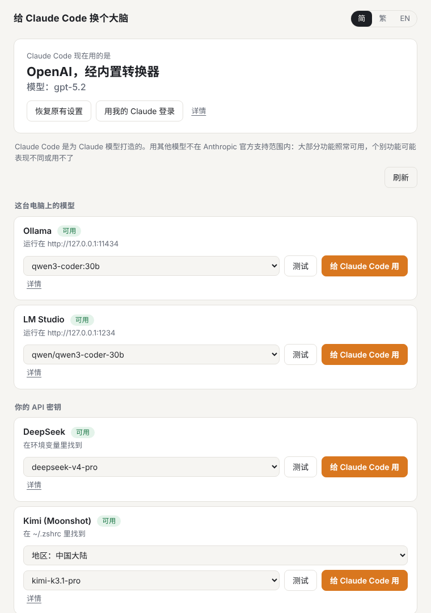

# wickrun-brain

给 Claude Code 换个大脑。一个小小的桌面应用：列出这台电脑能用的模型，点一下就让 Claude Code 改用其中一个；想回到原来的设置，也只要点一下。

[English](README.md) | 简体中文

<picture>
  <source media="(prefers-color-scheme: dark)" srcset="docs/screenshots/gui-zh-Hans-dark.png">
  
</picture>

## 下载

到 [Releases 页面](https://github.com/lifishard/wickrun-brain/releases) 下载对应系统的安装包：Windows 用 `.msi` 或 `.exe`，macOS 用 `.dmg`，Linux 用 `.deb`、`.rpm` 或 `.AppImage`。双击安装即可使用，不需要 Node.js、不需要终端，也不需要安装 wickrunAI。

安装包暂未签名，第一次打开时系统会提示：

- **Windows：** SmartScreen 提示「Windows 已保护你的电脑」。点**更多信息**，再点**仍要运行**。
- **macOS：** 如果提示应用「已损坏」或「无法打开」，打开**系统设置 → 隐私与安全性**，在 wickrun-brain 旁边点**仍要打开**。如果没有这个按钮，在「终端」里运行一次 `xattr -dr com.apple.quarantine /Applications/wickrun-brain.app`。
- **Linux：** AppImage 需要先加上执行权限（`chmod +x wickrun-brain_*.AppImage`）再运行。

## 界面上有什么

**顶部：** 用大白话告诉你 Claude Code 现在用的是什么，旁边是**恢复原有设置**（把设置文件恢复成本应用第一次改动前的样子，一字不差）和**用我的 Claude 登录**。

**下面：** 应用找到的所有来源，分组列出。每一项都有状态（可用、需要密钥、这里用不了）、模型选择（来源能列出模型时）、**测试**按钮（先发一个很小的请求试试）和**给 Claude Code 用**按钮。地址、存放密钥的设置项、打码后的密钥这些技术细节都收在**详情**里。

| 分组 | 找什么 | 怎么找 |
| --- | --- | --- |
| 这台电脑上的模型 | Ollama、LM Studio、llama.cpp server、vLLM、Jan | 查 127.0.0.1 上的默认端口（11434、1234、8080、8000、1337），从 `/api/tags` 或 `/v1/models` 读模型列表 |
| 你的 API 密钥 | DeepSeek、Kimi（Moonshot）、智谱 GLM、Z.ai、通义千问（DashScope）、MiniMax、OpenRouter、Anthropic、OpenAI、Google Gemini、Groq | 环境变量（例如 `DEEPSEEK_API_KEY`）、shell 配置文件里的 `export` 行（`~/.zshrc`、`~/.bashrc`、`~/.profile`、fish、PowerShell 配置）、`~/.codex/auth.json`，以及用 wickrun-brain 命令行工具保存的配置。只显示打码后的样子（`…7f3a`） |
| 来自 CC Switch | 你在 [CC Switch](https://github.com/farion1231/cc-switch) 里保存的 Claude Code 供应商 | 读取 `~/.cc-switch/cc-switch.db`（或你移动过去的目录，或旧版的 `config.json`）的临时副本，不会锁住或改动 CC Switch 自己的文件 |
| 这台电脑上的网关 | OmniRoute、Claude Code Router、LiteLLM、one-api、new-api | 查它们的默认端口（20128、3456、4000、3000）并确认是谁在应答。网关需要密钥时粘贴一次即可；LiteLLM 的 `LITELLM_MASTER_KEY` 和 Claude Code Router 的 `APIKEY` 会自动识别 |
| wickrunAI | 已安装的 wickrunAI 桌面版 | 只检查是否已安装。wickrunAI 没有公开的本机路由接口，所以这里显示「请在 wickrunAI 里切换」和打开它的按钮，绝不读取 wickrunAI 的私有存储 |

界面语言：简体中文、繁体中文（香港用语）、English。默认跟随系统语言，右上角可以切换。浅色和深色跟随系统。

## 两种连接方式

Claude Code 只说一种格式：Anthropic Messages API。来源有两种接法：

- **直连：** 来源本身就说这种格式。应用把它的地址、密钥和模型写进 Claude Code 的设置，之后就不再参与。包括 Ollama 0.14 及以上、LM Studio 0.4.1 及以上、DeepSeek、Kimi、GLM、通义千问、MiniMax、OpenRouter、Anthropic，以及提供 `/v1/messages` 的网关（OmniRoute、Claude Code Router、LiteLLM、new-api）。
- **经内置转换器：** 来源只说 OpenAI Chat Completions 格式（OpenAI、Gemini、Groq、llama.cpp、vLLM、Jan、one-api、旧版 Ollama、CC Switch 里标为「OpenAI 格式」的条目）。应用会在 `127.0.0.1` 的随机端口上运行一个小转换器。Claude Code 拿到的是每次切换时随机生成的口令，真正的密钥只留在应用里，不会写进 Claude Code 的设置。转换器需要保持运行：关掉窗口后应用会留在托盘（macOS 是菜单栏）。**开机自动启动**默认关闭。转换器没有运行时，窗口顶部会直接说明，并提供**恢复原有设置**。

**请注意：** Claude Code 是为 Claude 模型打造的。用其他模型不在 Anthropic 官方支持范围内：大部分功能照常可用，个别功能可能表现不同或用不了，Claude Code 更新后情况也可能变化。

### 经转换器时可能打折扣的地方

- **思考：** 扩展思考块会被丢弃（Chat Completions 没有带签名的思考块）；部分供应商流式返回的推理文字（`reasoning_content`）不会显示。
- **提示缓存：** `cache_control` 标记会被丢弃；会自动缓存的供应商仍会报告命中的 token。
- **服务端工具：** Anthropic 托管的工具（如网页搜索）用不了；Claude Code 自己的工具（Read、Edit、Bash 等）照常可用。
- **工具调用在一轮结束时一次给出**，不会逐段流式输出参数。文字照常流式输出。
- **token 计数**（`/context` 和自动压缩用到）是估算值（字符数 ÷ 4）。Claude Code 还会提示不认识这个模型名，并假定很大的上下文窗口，见[模型配置](https://code.claude.com/docs/en/model-config)。
- **PDF 等文档**会换成一句简短说明；图片以 data URL 传过去，模型本身支持图片才有效。
- **错误**（401、403、429、5xx）会转成 Anthropic 的错误格式返回，Claude Code 自己的重试和提示照常工作。

### 兼容信息的出处

| 来源 | 应用使用的地址 | 参考 |
| --- | --- | --- |
| Ollama | `http://127.0.0.1:11434`（内置 Anthropic API） | [Ollama：Anthropic 兼容](https://docs.ollama.com/api/anthropic-compatibility) |
| LM Studio | `http://127.0.0.1:1234` | [LM Studio：Claude Code](https://lmstudio.ai/docs/integrations/claude-code) |
| DeepSeek | `https://api.deepseek.com/anthropic` | [DeepSeek：Anthropic API](https://api-docs.deepseek.com/zh-cn/guides/anthropic_api) |
| Kimi | `https://api.moonshot.cn/anthropic`（中国大陆）、`https://api.moonshot.ai/anthropic`（国际） | [Kimi：Claude Code](https://platform.kimi.com/docs/guide/claude-code-kimi) |
| 智谱 GLM | `https://open.bigmodel.cn/api/anthropic` | [智谱：Claude API 兼容](https://docs.bigmodel.cn/cn/guide/develop/claude/introduction) |
| Z.ai | `https://api.z.ai/api/anthropic` | [Z.ai：Claude Code](https://docs.z.ai/devpack/tool/claude) |
| 通义千问（DashScope） | `https://dashscope-intl.aliyuncs.com/apps/anthropic`（国际）、`https://dashscope.aliyuncs.com/apps/anthropic`（中国大陆） | [百炼：Claude Code](https://www.alibabacloud.com/help/en/model-studio/claude-code) |
| MiniMax | `https://api.minimax.io/anthropic`（国际）、`https://api.minimaxi.com/anthropic`（中国大陆） | [MiniMax：Claude Code](https://platform.minimax.io/docs/token-plan/claude-code) |
| OpenRouter | `https://openrouter.ai/api` | [OpenRouter：Claude Code](https://openrouter.ai/docs/guides/coding-agents/claude-code-integration) |
| OmniRoute | `http://127.0.0.1:20128` | [OmniRoute：Claude Code 配置](https://github.com/diegosouzapw/OmniRoute/blob/main/docs/guides/CLAUDE-CODE-CONFIGURATION.md) |
| Claude Code Router | `http://127.0.0.1:3456` | [CCR：服务端 API](https://musistudio.github.io/claude-code-router/docs/server/api/overview) |
| LiteLLM | `http://127.0.0.1:4000` | [LiteLLM：Claude Code](https://docs.litellm.ai/docs/proxy/client_setup/claude_code) |
| one-api / new-api | `http://127.0.0.1:3000` | 应用会检查有没有 `/v1/messages`，没有就走转换器 |

真正可靠的检验是**测试**按钮：它会在改动任何设置之前，用你选的模型发一个很小的请求。

## 安全

应用沿用下方命令行工具的全部规则：

- 只改一个文件：Claude Code 的用户级 `settings.json`，而且只改其中的地址、密钥和模型设置。
- 第一次改动前，把原文件按字节存一份在旁边（`settings.json.before-wickrun-brain`）；**恢复原有设置**会一字不差地写回去。应用和命令行工具共用这份备份，谁改的都能由另一方还原。
- 每个选择都带上自己的密钥。只设地址会让 Claude Code 把你的 claude.ai 登录发到那个地址，所以应用绝不这样做。
- 如果 wickrunAI 正在管理 Claude Code，应用不做任何改动，并提示你在 wickrunAI 里切换。
- 写文件是原子操作（先写临时文件再改名）。密钥从不完整显示、从不写进日志，只发给你选中的来源。你粘贴的密钥存在应用自己的文件里（`~/.config/wickrun-brain/gui-state.json`，Windows 是 `%APPDATA%\wickrun-brain\`，macOS 和 Linux 上权限为 0600）。
- 联网只有这几种：在 127.0.0.1 上查找本机服务、向你选的来源列出模型和发送**测试**请求，以及你使用转换器时的转发。没有其他请求，没有遥测。

**macOS 提示：** 从程序坞启动的应用看不到你在 shell 里设置的变量，所以应用会读取 shell 配置文件里的 `export` 行；用其他方式设置的密钥（例如 shell 启动时由密码管理器注入）可能找不到，直接粘贴即可。

## 进阶：命令行工具和 Claude Code 插件

原来的命令行工具照常可用，也可以作为 Claude Code 插件安装。它不联网、也不运行转换器，所以适合本身就说 Anthropic 格式的来源。

<picture>
  <source media="(prefers-color-scheme: dark)" srcset="docs/demo/demo-zh-dark.svg">
  
</picture>

### 安装

在 Claude Code 里输入：

```
/plugin marketplace add lifishard/wickrun-brain
/plugin install wickrun-brain@wickrun
```

插件运行的是一个小的 Node.js 脚本，所以需要 `PATH` 上有 Node.js 18 或更新版本。除此之外没有任何依赖。

不用插件系统也可以：克隆仓库后直接运行脚本。

```
git clone https://github.com/lifishard/wickrun-brain
node wickrun-brain/scripts/wickrun-brain.mjs status
```

在克隆目录里执行 `npm link` 也能得到 `wickrun-brain` 命令。本项目没有发布到 npm。

### 30 秒上手

1. 在 Claude Code 里运行 `/wickrun-brain:status`，就能看到 Claude Code 用的是官方登录还是自定义端点，以及用的哪个模型。
2. 在**你自己的终端**里（不是 Claude Code 的对话框）保存一个配置。密钥从环境变量读取，绝不写在命令行上：

   ```
   export MY_GATEWAY_KEY=...        # PowerShell：$env:MY_GATEWAY_KEY = "..."
   wickrun-brain add work --base-url https://llm.example.com --model claude-sonnet-4-6 --key-env MY_GATEWAY_KEY
   ```

   也可以用 `--key-stdin` 从标准输入读密钥（手动输入时不回显）。如果网关要求 `x-api-key` 请求头而不是 Bearer 令牌，加上 `--auth x-api-key`。
3. 回到 Claude Code，运行 `/wickrun-brain:switch work`，然后开一个新会话。
4. 想回到原样：运行 `/wickrun-brain:restore`（恢复成一模一样的原文件），或 `/wickrun-brain:switch official`（只去掉覆盖项）。

不要把密钥粘贴进 Claude Code 的对话框：对话框里输入的一切都会发送给模型服务商。在 Claude Code 里运行 `/wickrun-brain:setup` 也能看到上面这些步骤。

全部命令：

| 命令 | 作用 |
| --- | --- |
| `status [--json]` | 显示设置文件路径、是否设置了受管键、端点主机、模型、打码后的密钥，以及当前由谁控制：`official login (no override)`（官方登录，无覆盖）、`custom endpoint`（自定义端点）或 `managed by wickrunAI desktop`（由 wickrunAI 桌面端接管） |
| `list [--json]` | 列出已保存的配置：名称、端点主机、模型、密钥来源。从不显示密钥 |
| `add <name> --base-url <url> --model <id> (--key-env <VAR> \| --key-stdin) [--auth bearer\|x-api-key] [--force]` | 保存配置。URL 必须是 http(s)，不能含用户名、密码、查询参数或片段。模型 ID 为 1 到 200 个字符，只能是字母、数字和 `. / : @ + - _` |
| `use <name> [--force]` | 把某个配置写进 settings.json |
| `official [--force]` | 删除全部受管键，让 Claude Code 回到官方登录，其他内容不动 |
| `restore [--force]` | 把 settings.json 恢复成本工具第一次修改之前的原始字节，然后删除备份 |
| `remove <name>` | 删除一个已保存的配置，不动 settings.json |

### 它到底改了什么

**只改一个文件**：Claude Code 的用户设置文件。设置了 `CLAUDE_CONFIG_DIR` 时是 `$CLAUDE_CONFIG_DIR/settings.json`，否则是 `~/.claude/settings.json`（Windows 上是 `%USERPROFILE%\.claude\settings.json`）。从不碰项目级设置文件。

**只改其中 `env` 对象里的这几个键**（“受管键”）：

| 键 | `use` 时设为 |
| --- | --- |
| `ANTHROPIC_BASE_URL` | 配置里的端点地址 |
| `ANTHROPIC_AUTH_TOKEN` | 密钥（默认，以 `Authorization: Bearer` 发送） |
| `ANTHROPIC_API_KEY` | 密钥，用 `--auth x-api-key` 添加的配置用它代替上一行 |
| `ANTHROPIC_MODEL` | 配置里的模型 |
| `ANTHROPIC_DEFAULT_OPUS_MODEL`、`ANTHROPIC_DEFAULT_SONNET_MODEL`、`ANTHROPIC_DEFAULT_HAIKU_MODEL`、`ANTHROPIC_DEFAULT_FABLE_MODEL` | 配置里的模型，这样 `/model` 别名和后台任务不会去请求端点不提供的模型 |
| `CLAUDE_CODE_SUBAGENT_MODEL` | 配置里的模型，供子代理使用 |

`use` 会先删掉全部受管键，再写入上表的值。`official` 删掉全部受管键。文件里的其他键、`env` 里的其他变量全部保留。如果 `env` 因此变空，就把它删掉。

文件会按 JSON 重新写出：2 空格缩进，保留键的顺序，保留原来有或没有的末尾换行，原文件用 Windows 换行时继续用 Windows 换行。原文件里的注释或特殊空白在 JSON 重写后无法保留；要逐字节还原，请用 `restore`。

**备份**：第一次修改之前，原始字节会保存在 settings.json 旁边，文件名是 `settings.json.before-wickrun-brain`（如果原来没有 settings.json，则创建一个空的标记文件 `settings.json.before-wickrun-brain.absent`）。已有的备份永远不会被覆盖，所以它始终是本工具第一次修改之前的状态。

**怎么还原**：`wickrun-brain restore`（或 `/wickrun-brain:restore`）把备份按字节写回，然后删除备份。如果原来没有 settings.json，还原时会把它删掉。注意：还原也会丢掉备份之后 settings.json 里的其他改动，比如你在 `/config` 里换的主题。想保留这些改动、只去掉端点和模型，请用 `official`。

**什么时候生效**：Claude Code 文档说，正在运行的会话会在文件保存时读到新增或修改的 `env` 值；删除一个变量要等下次启动 `claude` 才生效；有些功能只在启动时读一次变量（见 [环境变量](https://code.claude.com/docs/en/env-vars)、[设置](https://code.claude.com/docs/en/settings)）。文档没有说正在运行的会话会切换端点或凭据。所以本工具给出的是保守的建议：执行 `use`、`official` 或 `restore` 之后，开一个新的 Claude Code 会话。

### 安全说明

- **不联网。** 工具只用到 Node 的 `fs`、`path`、`os`、`crypto` 和 `url` 模块，不发送任何遥测数据。有测试专门检查导入的模块。
- **绝不复用 Claude 订阅登录。** 工具从不读取 OAuth 或凭据文件。每个配置都必须有自己的密钥：只设置 `ANTHROPIC_BASE_URL` 时，Claude Code 仍会发送已保存的 claude.ai 登录凭据（见 [LLM 网关文档](https://code.claude.com/docs/en/llm-gateway)），本工具不允许把这份登录指向第三方主机。
- **从不打印密钥。** 对 20 个字符及以上的密钥，输出最多显示最后 4 个字符（如 `…7f3a`），否则只显示 `set`。测试会跑遍所有命令，并在输出里搜索测试密钥。
- **密钥不上命令行。** `--key`、`--api-key` 之类的参数会被拒绝，因为命令行参数会留在 shell 历史里。请用 `--key-env`（环境变量名）或 `--key-stdin`。
- **配置存放位置**：`$XDG_CONFIG_HOME/wickrun-brain/profiles.json`，没有该变量时是 `~/.config/wickrun-brain/profiles.json`；Windows 上是 `%APPDATA%\wickrun-brain\profiles.json`。
- **哪些内容是明文保存的**：
  - 用 `--key-env` 添加的配置只保存变量名。运行 `use` 时这个变量必须已设置，否则会明确报错。
  - 用 `--key-stdin` 添加的配置会把**密钥本身以明文**存进配置文件。
  - 执行 `use` 之后，**密钥以明文写在 settings.json 里**，因为 Claude Code 就是从那里读取的。如果原来的 settings.json 里就有密钥，备份文件里也会有。
  - 在 macOS 和 Linux 上，这些文件以 0600 权限写入（只有你能读）。在 Windows 上，它们沿用用户目录的权限。
- **安全写入**：每次写入都先写到同一目录下的临时文件，再改名覆盖目标，中途崩溃也不会留下写了一半的 settings.json。如果 settings.json 不是有效 JSON，或者 `env` 不是对象，工具会拒绝执行，什么都不改。

### 常见问题

**能和 wickrunAI 应用一起用吗？**
可以，但一次只用一个。wickrunAI 桌面端也能接管 settings.json 里的这些键。`status` 能识别出来并显示 `managed by wickrunAI desktop`；这时 `use`、`official` 和 `restore` 会拒绝执行，并提示你到应用里切换或还原（加 `--force` 可以强制执行）。本工具从不碰应用自己的备份。

**能和 CC Switch 等其他切换工具一起用吗？**
它们改的是同一个文件。一次只用一个，用 `status` 查看 settings.json 当前的内容。如果别的工具在本工具之后又改了文件，`restore` 仍然会回到本工具第一次修改之前的原样。

**需要重启吗？**
切换后请开一个新的 Claude Code 会话，原因见上面的“什么时候生效”。

**会影响哪些 Claude Code 入口？**
终端里的 CLI 会读取 settings.json 里的 `env`。根据 Claude Code 的网关文档，VS Code 扩展在启动前从它自己的 `claudeCode.environmentVariables` 设置检查凭据，Claude 桌面应用从它自己的配置读取网关路由，而不是 settings.json（见 [连接网关](https://code.claude.com/docs/en/llm-gateway-connect)）。使用自定义端点或密钥时，Remote Control 不可用。

**支持哪些端点？**
任何兼容 Anthropic Messages API 的端点，比如你所在组织运行的 LLM 网关。工具不会检查端点（它不发任何网络请求）。端点背后接的是非 Claude 模型时，技术上可以这样用，但这不在 Anthropic 的官方支持范围内：效果和兼容性没有官方保证，Claude Code 更新后也可能失效。

**用了 `--auth x-api-key` 之后要我确认密钥？**
在交互会话里，`ANTHROPIC_API_KEY` 第一次覆盖你的登录前，Claude Code 会请你确认一次。这是 Claude Code 的行为，不是本工具的。

**怎么卸载？**
先运行 `wickrun-brain restore`（或 `official`），让 settings.json 不再指向你的配置。然后在 Claude Code 里运行 `/plugin uninstall wickrun-brain@wickrun` 和 `/plugin marketplace remove wickrun`。如果不再需要，把配置文件（路径见上文）也删掉。

## 关于 wickrunAI

wickrun-brain 免费开源，单独使用就完整可用。它出自 [wickrunAI](https://wickrunai.com)（灯芯AI）团队。wickrunAI 是一个桌面工作空间，多个模型和多个人在同一处协作：每个对话可以有自己的路由和模型，一条路由撞上限额，下一条自动接上。如果你只需要给 Claude Code 换大脑，这个应用就够了。

## 开发

```
cd app/src-tauri && cargo test   # 应用：设置读写、发现、打码、转换器
cd app && npx tauri build        # 为当前系统打包安装包
node --test                      # 运行测试（无依赖）
node scripts/build-demo.mjs      # 用真实的 CLI 输出重新生成 docs/demo/*.svg
node scripts/build-demo.mjs --frame 11 --lang zh --theme dark --out frame.svg   # 生成单帧静态图
```

## 许可证

MIT，Copyright (c) 2026 lifishard。见 [LICENSE](LICENSE)。

本项目与 Anthropic 无关联，也未获其认可。文中提到 “Claude Code” 仅用于说明兼容性。
